# 实验二：软件设计与建模

## 多人共享记账系统

课程：软件工程  
学号：241220051  
姓名：沈思涵  
日期：2026年10月29日  

<!-- pagebreak -->

## 一、实验目的与项目概述

本实验将实验一的需求分析转化为软件设计，练习面向对象的职责划分，使用PlantUML表达结构、行为与对象协作，并利用UI工具和可复用组件设计各功能模块。

项目为“多人共享记账系统”，面向室友、朋友出行及小型活动。成员录入公共收入或支出并分配金额，独立审核后计入正式账目，系统提供预算、统计、成员净余额及线下还款管理。例如A垫付120元，A、B、C均摊，审核后A应收80元，B、C各应付40元，净余额合计为零。系统不执行真实转账。

需求以实验一`requirements.md` V0.3的REQ-001～041为依据。设计覆盖收入、支出、审核、预算、查询统计、结算、权限和日志；不包括资金托管、多币种、银行同步、离线记账及比例/份数分摊。

## 二、主要功能与角色设计

### 2.1 功能模块及需求覆盖

| 模块 | 主要功能 | 需求依据 |
| --- | --- | --- |
| M01 账号与认证 | 名单开通、登录、首次改密、身份核验与凭据重置 | 001～003、032 |
| M02 账本管理 | 创建、空账本删除、归档、重开、历史留存 | 004、028、037 |
| M03 成员与权限 | 邀请、角色授撤、退出/移除、重新加入及历史范围 | 005～007、027、032 |
| M04 收支与分摊 | 草稿、收入/支出、平均/指定金额分配、分类及版本详情 | 008～011、013、017 |
| M05 审核与更正 | 独立审核、驳回、撤回、更正/作废及退款调整 | 012、014～016 |
| M06 预算管理 | 月预算、已用与剩余额度、超支提示 | 018～019 |
| M07 查询与统计 | 类别/成员/日期/金额筛选、收支及成员汇总 | 020～021 |
| M08 结算与还款 | 净余额、建议、登记、额度占用、确认/拒绝/撤销及纠错 | 022～026 |
| M09 审计与运维 | 业务与维护日志、备份恢复及留存 | 029～030、034、037 |

表中编号均为REQ编号。上述模块覆盖实验一的共享账本、至少三类用户、收支操作、查询、预算、统计和结算基本要求。版本模型提供七种状态，事务和审计处理数据同步及异常。REQ-031～036的性能、安全、完整性、恢复、适配和易用性贯穿各模块，REQ-038～041约束部署及资源条件。

### 2.2 身份与权限

账本角色包括普通成员、审核员、管理员。角色可以兼任，但管理权与审核权分别授予；管理员没有审核角色时不能审核，兼任也不能审核本人录入的版本。本人付款或参与分摊不等于本人录入，因此保存版本录入人，不能只比较付款人与审核人。

普通成员负责录入、本人申请和本人还款；审核员处理符合独立性条件的记录及申请；管理员管理成员、分类、预算与归档。已登录账号可以创建账本。账号维护人员负责开通和重置凭据，维护身份不自动获得业务账本访问权。退出成员按在册历史区间查看及处理本人往来，重新加入不恢复原管理或审核角色。

### 2.3 关键业务规则

金额以人民币整数分保存，平均分配尾差按首次加入顺序补分，分配合计必须等于原金额。只有已审核、当前生效且未作废的版本参与正式统计、预算和余额；收入不占支出预算，退款通过更正原支出处理。

同一收支至多一个生效版本。更正申请处理前原版本继续生效，通过后切换生效指针；作废通过后清空指针。待确认还款占用额度，收款人确认到账后才改变余额；所有成员净余额之和为零。归档、退出和作废保留历史关联及日志。

## 三、整体架构与面向对象设计

### 3.1 架构选择与模块协作

系统采用响应式Web前端、模块化单体后端和关系数据库。前端为React、TypeScript、Vite与shadcn/ui，沿用SDS青绿tokens；后端采用FastAPI，数据使用PostgreSQL，由Nginx统一提供静态资源与API入口。

选择模块化单体，是因为审核通过会同时影响版本、预算、余额、待确认还款与日志，同一数据库事务便于保证整体成功或回滚。模块按职责隔离，通过服务接口协作。前端共享基础组件与业务组件，MobileShell组织手机任务，AdminShell组织桌面队列与详情，避免双端重复维护业务表达。

| 场景 | 模块交互 | 设计理由 |
| --- | --- | --- |
| 创建账本、邀请加入 | 认证→账本→成员/角色/邀请→审计 | 账本与初始身份同步建立；邀请一次成功使用，重入复用成员身份 |
| 提交收支 | 收支/分配→权限及账本状态→审计 | 先校验再进入待审，提交不等于正式入账 |
| 审核、更正或作废 | 审核/申请→版本→预算→结算→审计 | 生效切换、金额变化及日志同事务，避免重复累计 |
| 还款确认或纠错 | 本人身份→还款→余额快照→失效检查→审计 | 只能由对应本人处理；余额变化统一检查待确认还款 |
| 查询与统计 | 认证/历史授权→查询→生效版本汇总 | 筛选不扩大权限，详情、预算与统计口径一致 |

### 3.2 领域对象与持久化

User表示账号，Membership表示账号在某账本中的身份；MembershipRole记录角色授撤，MembershipPeriod记录加入/退出区间。账号与账本身份分离，支持同一用户加入多个账本、兼任角色并保留历史。

Transaction保存稳定业务身份，TransactionVersion保存版本，Allocation保存成员承担或享有金额。生效指针选择参与计算的版本，避免覆盖旧金额。Category归属账本；ChangeRequest保存更正/作废的依据版本、原因及尝试次数。Repayment与RepaymentCorrection分别表示还款及其纠错，AuditLog保存动作、对象、前后值、原因与关联标识。

分配策略、审核命令和余额变更后的统一检查分别由`AllocationPolicy`、`ReviewService`与`SettlementService`封装。页面负责输入与呈现，应用服务编排事务，领域模块判断规则，Repository负责数据访问。

| 数据设计 | 关键约束 |
| --- | --- |
| 账号与会话 | 保存口令摘要、首次改密标记和服务端失败计数，不保存明文口令 |
| 成员与角色 | `(ledger_id,user_id)`唯一；同一成员同一角色最多一项未撤销授权，以部分唯一约束实现 |
| 收支与分配 | 金额为BIGINT整数分；版本号唯一，关联对象属于同一账本，分配金额守恒 |
| 生效版本与申请 | 首次通过设置指针，更正迁移，作废清空；每笔收支最多一项待处理申请 |
| 预算、还款与日志 | 账本/月预算唯一；保留还款纠错替代关系；业务审计与幂等结果同事务写入 |

业务日期按北京时间自然日确定预算月份，时间戳以UTC保存；按账本、日期及稳定排序键分页，并对常用查询字段建立索引。

### 3.3 事务、异常与非功能设计

写操作顺序为：鉴权→事务→同幂等键串行化→读取原结果或判断键冲突→固定顺序锁账本、收支、版本与还款→重查角色/状态/版本/额度→写业务、日志和幂等结果→提交。同键同请求返回原结果，同键不同请求拒绝；取得锁后再次检查权限，不能依赖旧页面按钮。

字段不合法时就近显示文字错误，服务端再次校验；状态/版本竞争返回冲突并刷新；数据库失败整体回滚。审核及还款导致余额变化后，使用同一变更后快照判定全部待确认还款的失效集合，不能边撤销边缩小判断范围。

安全设计通过账本隔离、服务端授权和日志同范围查询落实。界面使用16px正文、44px触控区，适配360/390/768/1440宽度。响应目标为约定规模、10并发会话下九类操作各100次至少95次在2秒内完整成功；易用性目标为5名合格新用户中至少4人一分钟内完成120元三人均摊及预览。备份成功间隔不超过24小时，保留至少7次成功备份，接报4小时内恢复；业务历史从最后变更起至少保存3年。

## 四、UML建模

### 4.1 图种分类与选择

结构图描述组织关系，行为图描述状态或流程，交互图描述对象间消息。按课程三类口径，正文选用类图、组件图、活动图、时序图共4种，覆盖三类并包含必画类图；时序图与序列图均指Sequence Diagram，不重复计数。全部图使用PlantUML绘制。

| 类别 | 图种及用途 | 本项目取舍 |
| --- | --- | --- |
| 结构性 | 类图：类与关联；对象图：实例快照；组件图：模块依赖 | 选类图和组件图表达领域模型与架构 |
| 结构性 | 复合结构图：内部部件和端口；部署图：运行节点；包图：包依赖；剖面图：模型扩展 | 另以部署图表达节点；其余不重复绘制，系统无需自定义UML扩展 |
| 行为性 | 活动图：步骤与分支；用例图：角色目标；状态图：生命周期 | 正文选活动图；角色与七状态由文字说明，用例和状态详图随附件保存 |
| 交互性 | 通信图：连接与消息编号；交互概览图：交互控制流；时序/序列图：消息时间顺序 | 选时序图，清楚表达审核、幂等与事务先后 |

### 4.2 UML类图：领域对象及关联

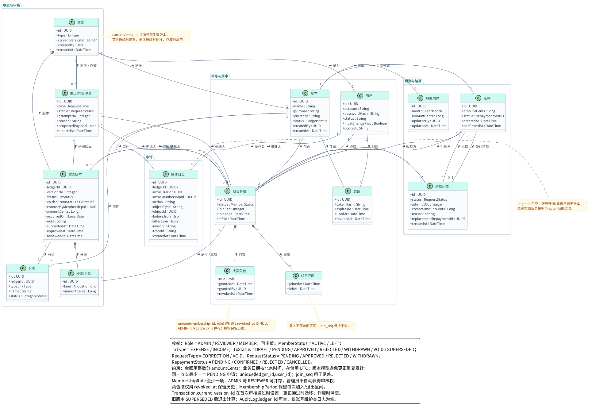

User与Membership分离账号和账本身份；角色关联及成员区间保存兼任与历史。Transaction通过版本及生效指针关联正式账目，Allocation表达一对多分配，版本录入人与付款人分别关联。收支申请与还款纠错独立建模，使不同处理人和守卫条件保持清晰。

### 4.3 UML组件图：模块划分与依赖

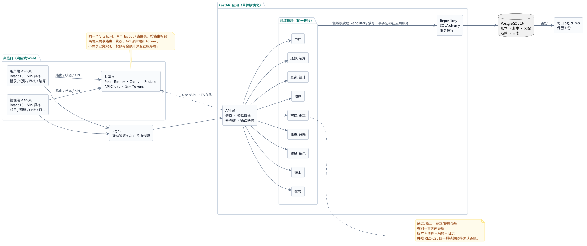

两个前端壳层共享组件、路由、状态与API调用，经统一入口访问FastAPI领域模块。应用服务组织事务，模块通过Repository访问PostgreSQL。将审核、预算、结算与审计保留在单体内，能够在明确的依赖关系下保证跨模块一致性。

### 4.4 UML活动图：录入与审核

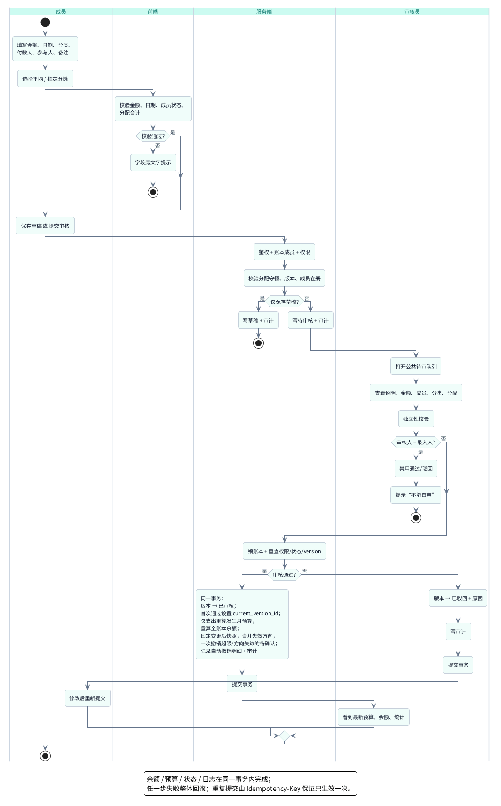

泳道区分成员、前端、服务端和审核员。保存草稿与提交审核分支分开；审核员明确选择通过或驳回后，服务端重新校验权限与状态。通过同步更新版本、预算、余额和日志，驳回保留原因供修改重提，避免把提交视为生效。

### 4.5 UML时序图：审核通过与幂等

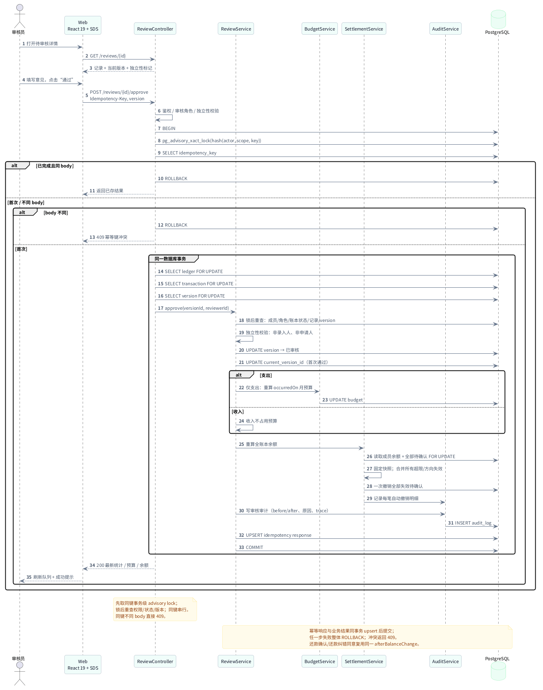

审核员请求经Controller进入ReviewService，同键串行化后区分结果回放、内容冲突及首次执行；锁后复核身份、版本与独立性。成功路径更新生效版本，调用预算与结算服务，在固定快照上撤销失效还款，并与审计、幂等结果一同提交；任一步失败整体回滚。

## 五、各功能模块UI设计

### 5.1 视觉规范与组件复用

UI以本地React与shadcn/ui原型统一绘制和渲染。SDS tokens是唯一视觉来源，青绿主色#0F766E，8px圆角、1px边框、无卡片阴影；基础件经语义变量映射到SDS，再组合成页面。MoneyText、StatusBadge、MemberAvatar、AllocationList和ReviewDetail统一表达金额、状态、成员、分配与审核详情。

手机页面采用单列任务布局，桌面采用队列与详情并列；错误同时提供文字和图标，审核禁用附原因，通过前二次确认，驳回原因必填。登录与维护端使用独立布局，维护身份不展示业务账本数据。

### 5.2 功能与界面对应

| 模块/页面编号 | 界面及功能 | 关键交互设计 |
| --- | --- | --- |
| M01：01、17 | 登录/首次改密、账号维护 | 统一登录错误，第五次连续失败起暂停15分钟；原渠道核验后重置，强制改密，不显示明文密码 |
| M02：02、03、16 | 账本列表、首页、设置归档 | 列表显示状态与身份；首页集中余额、预算、待办；归档前列出未结事项，保留历史 |
| M03：04、05 | 成员邀请、邀请接收 | 显示角色和加入顺序；邀请7天有效且成功使用一次即失效，确认目标账本后加入 |
| M04：06～09 | 支出、收入、列表、详情 | 金额优先；分别选择付款/收款人与参与成员；平均/指定分配，展示版本及审核原因 |
| M05：10～12 | 桌面审核、移动审核、更正作废 | 双端复用ReviewDetail；不能自审；原值/新值并列，处理前原记录继续有效 |
| M06、M07：08、13 | 账目筛选、预算统计 | 按类别/成员/日期/金额筛选；区分已审核与待审；超支仅提示，更正回算发生月 |
| M08：14 | 结算与还款 | 区分净余额、待确认占用、可收/可付；由实际付款人登记、收款人确认，纠错不与收支更正混淆 |
| M09：15、17 | 操作日志、维护审计 | 显示操作者、对象、前后值、原因和关联标识；日志查询不扩大业务权限 |

例如100.01元三人均摊，预览为33.34、33.34、33.33元；分配合计与原金额一致。审核前不计入正式预算和余额。浏览器操作核对了字段错误、自审限制、审核确认、驳回原因、还款确认及代表尺寸布局；本地构建通过。

### 5.3 界面总览：账号、账本与成员

<!-- ui-overview -->
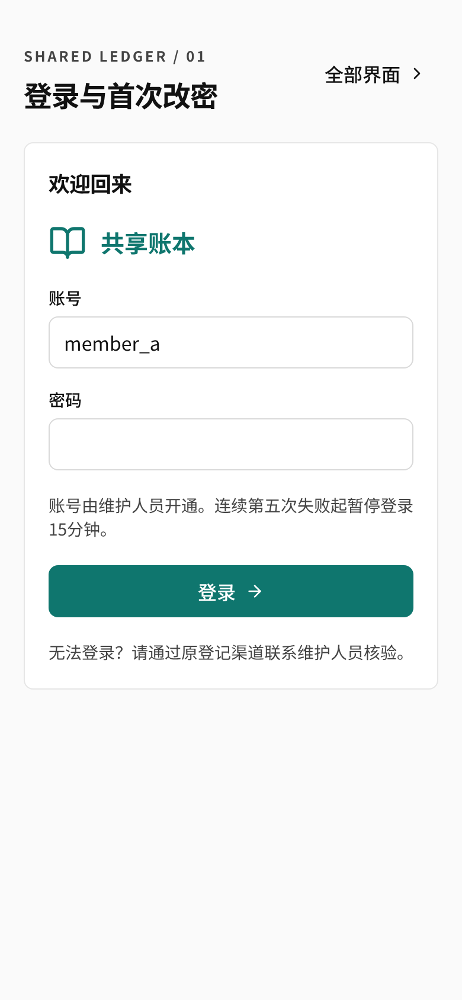
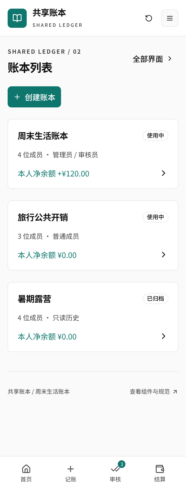
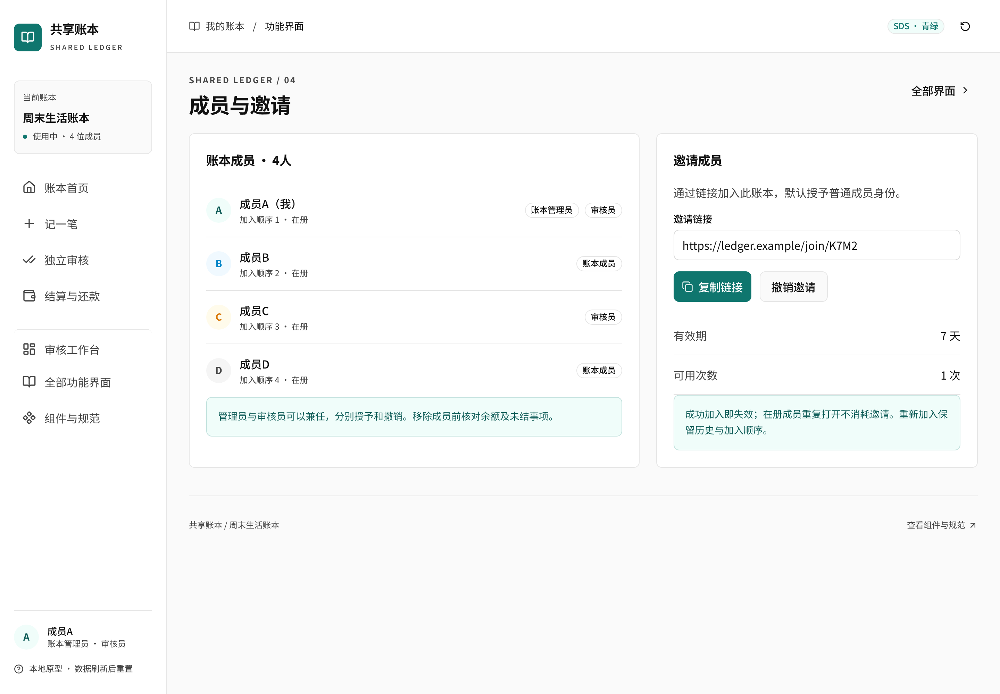
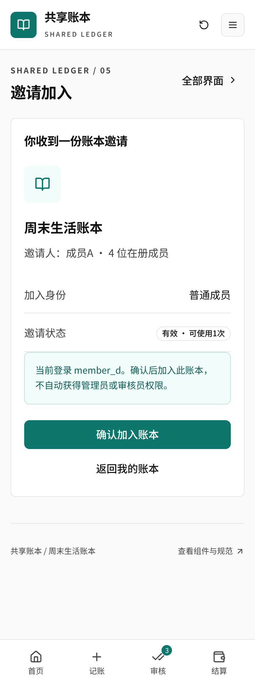
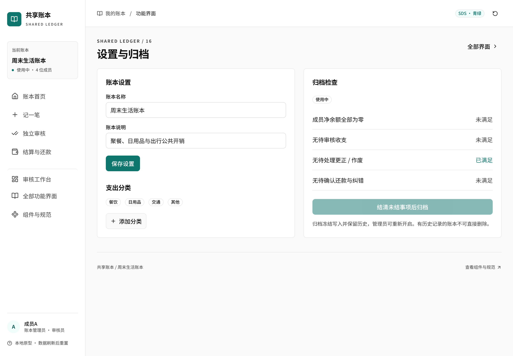
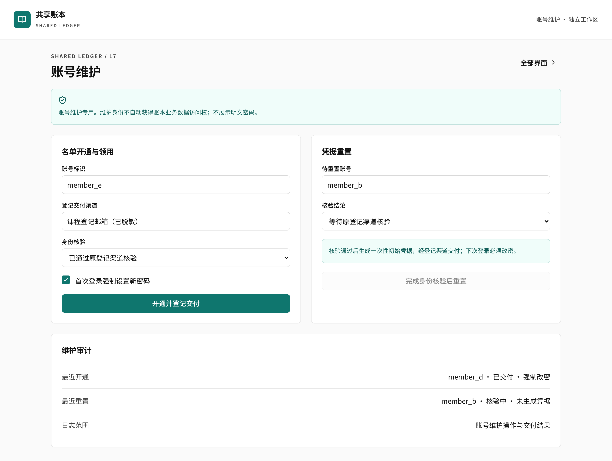
<!-- /ui-overview -->

### 5.4 界面总览：日常记账与审核

<!-- ui-overview -->
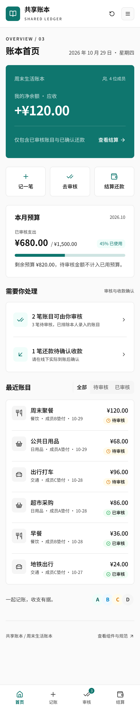
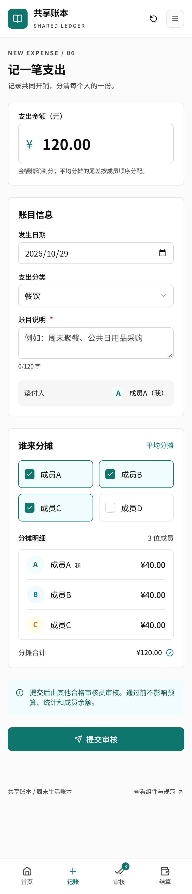
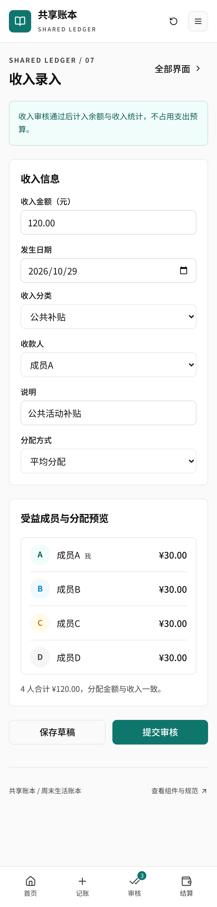
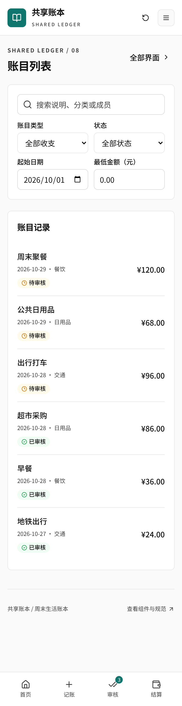
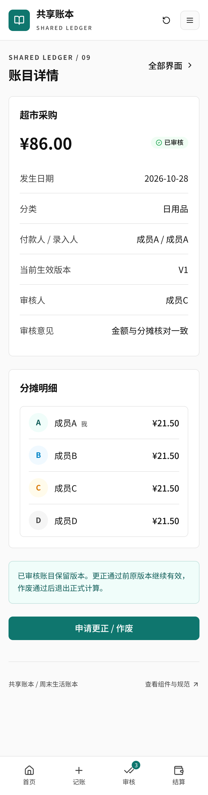
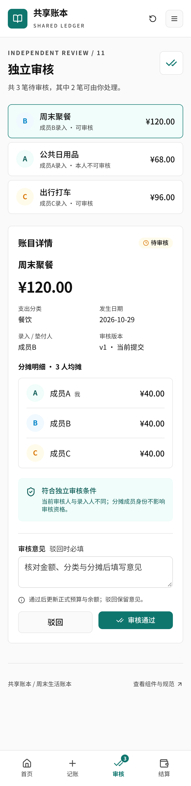
<!-- /ui-overview -->

### 5.5 界面总览：管理与结算

<!-- ui-overview -->
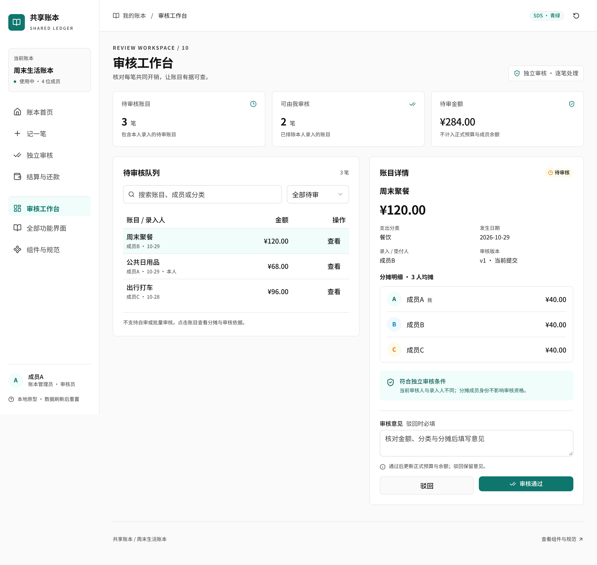
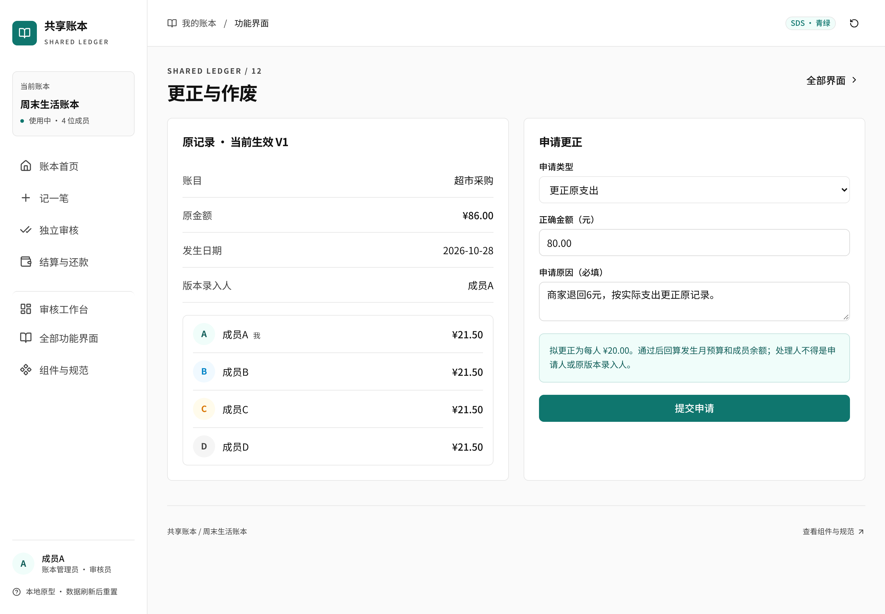
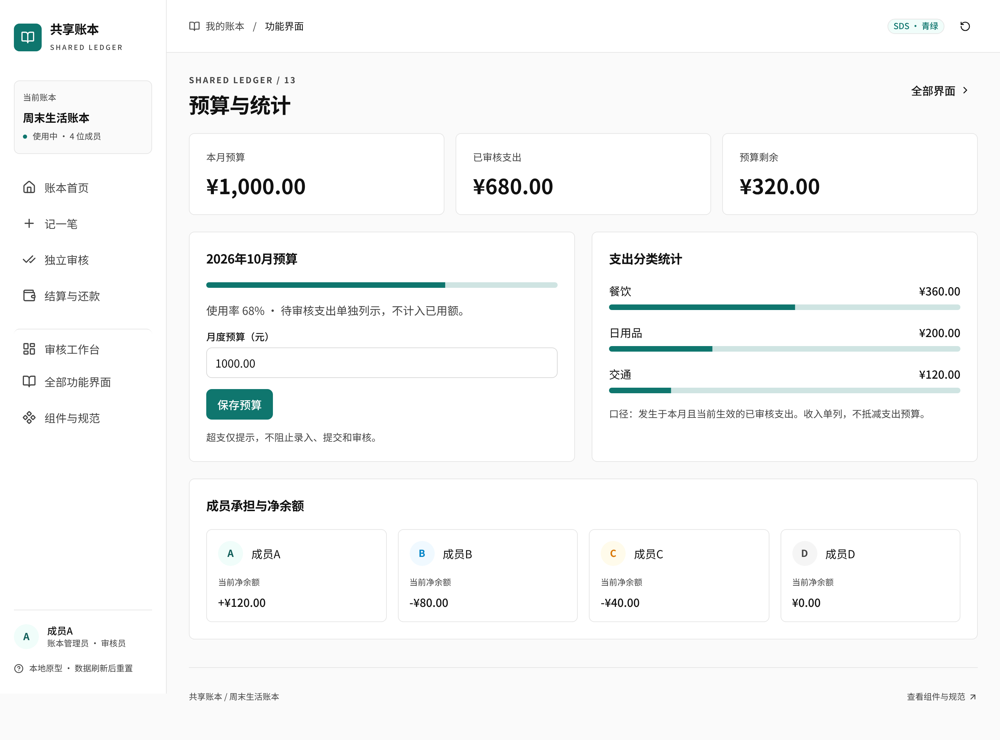
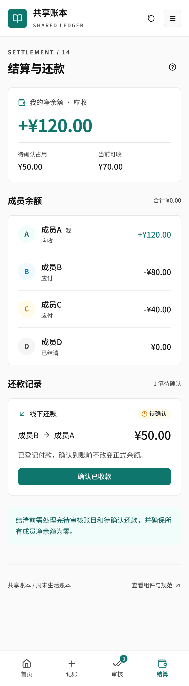
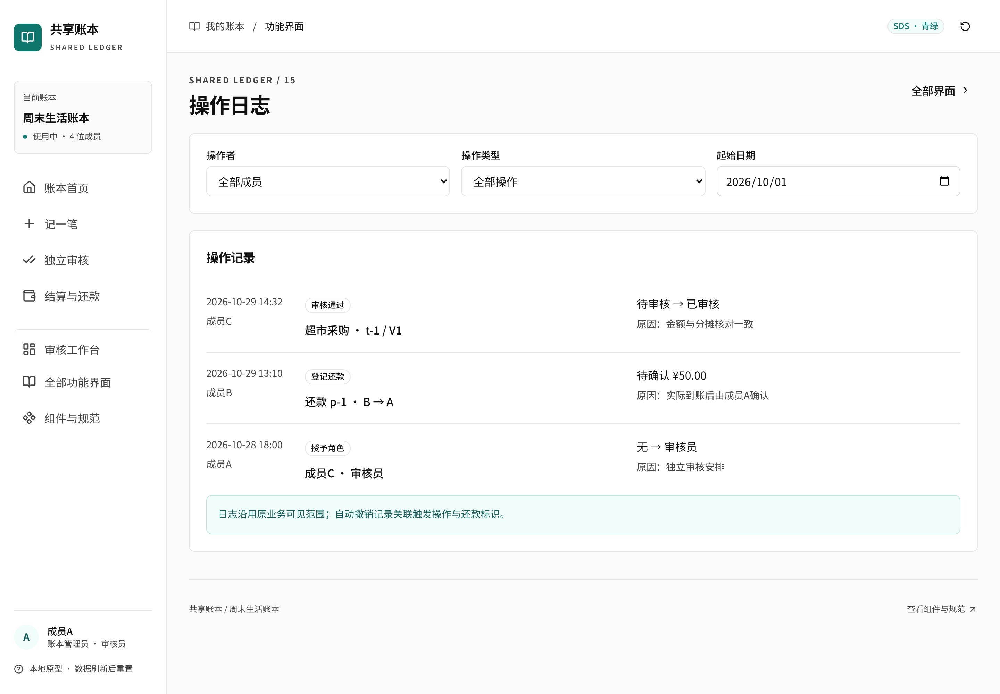
<!-- /ui-overview -->

## 六、AI辅助工具使用与本人思考

### 6.1 分工与逐次记录

我先设计架构，与AI讨论后决定技术栈及UI风格，再由AI生成UML并进行人工审核。界面选择本地shadcn/ui、SDS青绿和组件复用。AI辅助形成图源、候选界面、设计审查及报告，我判断范围、架构取舍与表达是否符合需求。

| 事件/场景 | 生成结果与优缺点 | 判断、修改及优化结果 |
| --- | --- | --- |
| AI-01 技术讨论 | 比较React单栈、双壳、SDS与后端；比较快，但易混淆设计库与代码库 | 经讨论确定技术栈与风格，采用shadcn基础件及共享tokens |
| AI-02 UML生成 | 生成PlantUML图；便于迭代，但初版角色、多重性与版本状态有误 | 人工审核图源，结合审查完善角色关联、生效指针与历史区间 |
| AI-03 设计审查 | 辅助审查形成D01～D10；能找跨文件矛盾，但建议需对照需求 | 统一权限、版本、事务与数据口径 |
| AI-04 多轮复核 | 多轮复核形成N01～N08、R01～R04；能追踪遗漏，多轮仍有残留 | 补部分唯一约束、录入人、申请尝试与统一锁序 |
| AI-05 视觉比较 | HTML/CSS稿比较Material3与SDS；直观，但旧稿字号和层级不足 | 选择SDS青绿，优化正文、表单与状态表达 |
| AI-06 Figma探索 | SDS页面与部分组件；可编辑，但批量操作成本较高 | 整理按钮、分配行、标签与操作层级，示例成员匿名化 |
| AI-07 本地原型 | 基础件、业务件及五屏；可检查共享状态，但曾出现刷新白屏 | 修正懒加载导入，核对布局、焦点及交互 |
| AI-08 报告整理 | 生成Markdown、PDF及素材；组织效率高，但初稿冗长且截图版本不一致 | 按本人意见精简措辞与篇幅，统一17个功能页面效果图；正文保留4种UML与3页UI总览，完整图像单独保存 |

### 6.2 代表性设计判断

角色模型不能只用一个role字段，否则难以表达管理员兼任审核员；改为角色关联，分别授权并保留撤权历史。收支更正不能直接覆盖原金额，否则旧值难追踪且可能重复累计；使用稳定收支身份、历史版本及生效指针统一预算和余额口径。

幂等与事务需要对照图和文字检查。初稿的写入时点、同键并发和唯一约束曾不一致，复核后明确同键串行化、锁后校验以及业务/日志/幂等同事务。模型提出修复建议后仍需检查实际图源，不能只看“已修”结论。

报告审核也属于设计判断。我要求统一UI风格、替换混用的旧图，并将正文中的完整截图调整为总览，保留模块说明和必要的UML，让正文便于理解，高清附件便于查看细节。上述意见由本人提出，具体文字与图像整理由AI辅助执行。

### 6.3 工具评价与工作流

AI适合把明确规则快速转为图源、组件和说明，也能发现跨文件矛盾；缺点是可能混淆参与者、遗漏守卫、多重性或金额约束，并使材料冗长。对我而言，需求范围、技术路线、角色权限、金额生效和最终表达仍需人工判断，整齐的生成物不等于正确设计。

可将工作流组织为：本人确定范围与不变量→AI按编号需求生成小批图源/组件→语法、构建及引用检查→AI对照需求审查→本人逐项判断、修改或保留→重新渲染核对→分别保存生成稿、审核意见和实际修订。这样可以让人主要投入检查校对，但这里的“校对”包含实质设计判断，不能只检查错别字。每次使用记录场景、结果、优缺点、修改者及优化结果。

## 参考资料

1. 课程《实验二：软件设计与建模》任务书；实验一`requirements.md` V0.3；本地方案、设计审查、PlantUML图源与UI原型记录。
2. OMG：[UML 2.5.1](https://www.omg.org/spec/UML/2.5.1)。
3. PlantUML：[类图](https://plantuml.com/class-diagram)、[组件图](https://plantuml.com/component-diagram)、[活动图](https://plantuml.com/activity-diagram-beta)、[时序图](https://plantuml.com/sequence-diagram)。
4. shadcn/ui：[主题](https://ui.shadcn.com/docs/theming)；[Figma SDS源码](https://github.com/figma/sds)。
