# 实验二：软件设计与建模

## 多人共享记账系统

课程：软件工程  
学号：241220051  
姓名：沈思涵  
日期：2026年10月29日  
版本：V0.1，AI 辅助报告草稿，待本人审定

**编写说明。** 本报告依据实验一《多人共享记账系统需求列表》V0.3、现有 PlantUML 图源、设计审查记录及本地 UI 原型整理。本人已确认：技术栈和 UI 风格经与 AI 讨论后确定，先设计架构，再由 AI 生成 UML 图并进行人工审核。具体人工审核意见、手工修改内容和提交对应关系仍需补录。本报告区分“完整系统的设计方案”和“已经存在的界面原型”，不把未实现的后端、全模块 UI、系统验收或人工修改记录写成已完成。

**本次课程截止时间：2026年11月6日23:59，提交至 cslab-cms。** 该日期是实验二材料的提交期限，不是需求 REQ-040 中尚待双方确认的软件交付日期。本文件为草稿，不是可直接提交的最终报告。

<!-- pagebreak -->

## 一、实验目的与项目概述

### 1.1 实验目的

本实验将实验一的需求分析转化为可供后续实现的软件设计，重点完成三项工作：运用面向对象方法划分职责、实体和关系；用不同视角的 UML 图描述系统结构、行为与对象协作；利用 UI 设计工具和可复用组件表达各功能模块的界面及操作流程。

设计需要回答的不只是“有哪些页面”，还包括谁能操作、记录何时生效、数据如何关联、失败时怎样保持一致，以及怎样留下可追溯的修改记录。

### 1.2 项目选择与应用场景

本项目选择“多人共享记账系统”，面向室友、朋友共同出行或小型活动中的共同收支。成员在共享账本中录入收入与支出，确定参与分摊或分配的成员，经独立审核后计入正式账目；系统再提供分类统计、成员净余额、预算和线下还款管理。

例如，成员A垫付聚餐费120元，A、B、C三人均摊，每人承担40元。记录通过审核后，A的净余额增加80元，B、C各减少40元；净余额正数表示应收，负数表示应付。系统登记和核对线下还款，不进行真实转账。

### 1.3 需求依据与范围

需求基线为 `requirements.md` V0.3，包含 REQ-001 至 REQ-041。冲突规则以该文档给出的来源优先级为准，不重新采用早期“暂不做收入、审核或预算”的排除项。实验二保留完整设计范围，但不要求此时已经完成可运行业务系统。

本期完整设计包括共享账本、三类账本角色、收入与支出、审核及更正、预算、查询统计、结算还款、关键日志及账号维护。真实支付、资金托管、多币种、公共账户、银行同步、离线记账、比例/份数分摊均不在本期范围。图片附件、导入导出、提醒和周期记账延后处理。

### 1.4 当前成果与设计边界

截至本稿日期，已有9份 PlantUML 图源及对应图像；现有本地 React 原型实现了首页、支出录入、独立审核、结算还款、管理审核工作台五个业务页面及一个组件展示页。另有此前保存的 Figma 五屏草图证据和覆盖多数模块的静态 HTML/CSS 参考稿。

FastAPI、PostgreSQL、真实登录、服务端权限、事务、并发、备份与完整17屏仍属于设计或后续实现内容。当前原型只使用浏览器内存示例，刷新会重置。原型中存在演示状态计算，不代表业务规则已经在服务端实现或通过验收。

## 二、主要功能、角色与需求覆盖

### 2.1 功能模块划分

模块按业务职责划分，不按网页数量划分。一个模块可以对应多个界面，一个界面也可以组合相关模块的信息，但不能因此省略权限或数据约束。

| 模块 | 主要功能 | 关联需求 |
| --- | --- | --- |
| M01 账号与认证 | 名单开通、凭据交付、首次改密、登录、重置及身份核验 | REQ-001～003、032 |
| M02 账本管理 | 创建、空账本删除、归档、重开及历史保留 | REQ-004、028、037 |
| M03 成员与权限 | 邀请加入、角色授撤、退出/移除、重入与历史区间 | REQ-005～007、027、032 |
| M04 收支与分摊 | 草稿、收入/支出、平均/指定分配、分类、查询基础数据 | REQ-008～011、013、017 |
| M05 审核与更正 | 审核、驳回、撤回、更正/作废申请、退款调整 | REQ-012、014～016 |
| M06 预算管理 | 按月预算设置、已用/剩余计算、超支提示 | REQ-018～019 |
| M07 查询与统计 | 类别/成员/日期/金额筛选，收支、分类与成员汇总 | REQ-020～021 |
| M08 结算与还款 | 净余额、建议、登记、占用、确认/拒绝/撤销、历史纠错 | REQ-022～026 |
| M09 审计与运维 | 关键日志、账号维护日志、备份恢复和留存 | REQ-029～030、034、037 |

REQ-031～036 的性能、访问隔离、完整性、恢复、适配和易用性贯穿各模块；REQ-038～041 约束部署、资源落实、工期和条件性迁移，不以单独增加菜单代替落实。

### 2.2 实验一基本要求对照

| 实验一要求 | 设计落点 | 主要 UML / UI |
| --- | --- | --- |
| 创建账本、邀请/退出、成员权限 | M02、M03；成员身份和角色分离 | 类图、用例图；账本列表、成员邀请 |
| 新增、修改、撤回、审核、驳回、作废收支 | M04、M05；版本化收支与申请机制 | 收支状态图、活动图、时序图；录入与审核 |
| 类别/成员/时间/金额查询，预算、统计、结算 | M06～M08；统一有效账目口径 | 组件图、用例图；列表、预算统计、结算 |
| 至少三种用户类型 | 管理员、审核员、普通成员；维护职责另设 | 用例图、角色关系；权限提示与禁用状态 |
| 至少四个有效状态及转换限制 | 收支版本七状态 | 收支版本状态图 |
| 数据关联、唯一性及同步更新 | 外键、部分唯一约束、生效版本指针、事务 | 类图、审核时序图 |
| 至少两类异常与日志 | 字段错误、重复提交、状态冲突、越权等 | 活动图、时序图；文字错误与操作日志 |
| 可量化非功能要求 | 引用既有响应、备份、适配、易用性指标 | 部署图、第五/六章设计说明 |

### 2.3 用户类型与权限设计

账本角色包括普通成员、审核员和管理员；同一成员可以兼任管理员与审核员，但管理员身份本身不授予审核权。平台维护人员负责开通和重置账号，维护权限不自动赋予账本业务权限。退出成员保留受限的历史查看和本人往来处理能力，不保留原管理或审核权。

| 身份 | 允许的代表操作 | 关键限制 |
| --- | --- | --- |
| 已登录账号 | 创建账本、接受有效邀请 | 加入前不得读取账目；创建后成为该账本管理员 |
| 普通成员 | 录入、本人草稿/未生效记录、本人申请、查生效账、本人还款 | 不审核他人记录，不设置预算或授予角色 |
| 审核员 | 查看允许范围，审核及处理更正/作废申请 | 不能是该版本录入人；处理申请时也不能是申请人 |
| 管理员 | 成员/分类/预算/归档等管理，按范围查看记录 | 没有审核角色不能审核；有审核角色仍不能自审 |
| 退出成员 | 按在册历史范围查看，处理本人历史往来 | 不查看退出后新增业务，不恢复旧角色 |
| 账号维护人员 | 开通/重置账号、核验领用渠道、维护日志 | 不因维护职责读取全部账本或代替本人还款确认 |

“能够查看”与“能够审核”分别判断。本人付款、收款或参与分配，并不必然禁止审核；限制依据是版本录入人及申请人。因此正式系统必须保存 `enteredByMembershipId`，不能仅比较付款人和审核人。当前五屏原型将录入人与垫付人固定为同一人，是演示数据的简化，不能作为正式权限实现。

### 2.4 关键业务不变量

- 收支金额使用人民币整数分；分配合计等于原金额，平均分配尾差按首次加入顺序补分，禁止浮点金额累计。
- 只有“已审核、当前生效、未作废”的版本参与正式统计、预算和余额；同一收支最多一个生效版本。
- 收入与支出分别计算分配；收入不占用支出预算，商家退款通过调整原支出处理。
- 所有成员净余额合计为零；待确认还款占用额度，但在收款人确认前不改变正式余额。
- 更正/作废申请待处理期间，原记录继续生效；余额变更后对全部待确认还款按同一快照判定失效，不能边撤销边缩小本次范围。
- 归档前需满足约定条件；退出、作废、归档不能破坏历史关联、日志或本人应有的历史查看范围。

## 三、整体架构与面向对象设计

### 3.1 架构选择及原因

完整系统采用“响应式 Web 前端 + 模块化单体后端 + 关系数据库”。前端为 React 19、TypeScript、Vite 和 shadcn/ui，视觉沿用 SDS 青绿 tokens；后端设计为 FastAPI，持久化使用 PostgreSQL，静态资源与 API 入口由 Nginx 统一提供。

选择模块化单体的原因是：项目核心难点在跨模块金额与权限一致性，而非独立扩容。审核通过同时影响版本、预算、余额、待确认还款和日志，将这些领域模块保留在同一服务和同一数据库事务内，更容易明确整体成功或回滚的边界。各模块通过服务接口协作，避免直接操作其他模块内部数据。

前端使用同一个应用下的 MobileShell 和 AdminShell。手机高频操作保持单列和大触控区，桌面管理端突出队列与详情；共享基础组件、领域显示组件、主题与状态表达，减少双端各自维护一套规则的成本。管理任务在手机下应能完成，不仅是缩小显示。

### 3.2 分层职责

| 层次 | 职责 | 不承担的职责 |
| --- | --- | --- |
| 页面与布局层 | 路由、任务流程、信息层级、响应式组合 | 作为最终权限判断来源 |
| 基础/业务组件层 | 通用交互、金额/状态/成员/分摊的复用表达 | 复制每个页面的按钮和弹窗实现 |
| API/应用服务层 | 会话、参数、命令编排、事务、幂等与错误映射 | 将事务拆成若干独立成功操作 |
| 领域模块层 | 审核资格、版本生效、分配、预算、余额与纠错规则 | 依赖页面是否隐藏了按钮 |
| Repository/数据库层 | 持久化、查询、外键、唯一约束、行锁 | 替代全部业务规则或使用进程锁保证跨实例一致性 |

### 3.3 模块之间的交互

| 触发场景 | 模块协作顺序 | 一致性要求 |
| --- | --- | --- |
| 创建账本 | 认证 → 账本 → 成员/角色 → 审计 | 账本与创建者管理员关系一起建立 |
| 邀请加入 | 认证 → 成员/邀请 → 账本状态 → 审计 | 链接一次成功使用；重入不产生第二个成员身份 |
| 提交收支 | 收支/分配 → 权限/账本 → 审计 | 校验通过后进入待审，不提前入正式账 |
| 审核通过 | 审核 → 收支版本 → 预算 → 结算 → 审计 | 相关状态、金额、自动撤销、幂等结果同事务 |
| 更正/作废通过 | 申请 → 独立审核 → 版本指针 → 预算/余额 → 还款检查 → 审计 | 原版本退出与新结果生效不能重复累计 |
| 还款确认/纠错 | 本人身份 → 还款 → 余额快照 → 统一撤销 → 审计 | 不由管理员代确认；失败完整回滚 |
| 查询/统计 | 认证/历史授权 → 查询 → 当前生效账汇总 | 筛选不得扩大权限，统计与详情口径一致 |

### 3.4 领域对象与职责分配

用户 User 表示账号，Membership 表示账号在某账本中的身份，两者分离使一个账号可以加入多个账本并拥有不同角色。MembershipRole 保存授予和撤销时间，MembershipPeriod 保存多次加入/退出区间，避免重新加入覆盖历史。

Transaction 表示一笔稳定的业务记录，TransactionVersion 保存每次版本内容。用稳定记录关联历史，用生效指针选择参与计算的版本，避免直接覆盖已审核金额。Allocation 记录该版本对成员的承担或享有金额；Category 与账本关联，防止跨账本引用分类。

ChangeRequest 表示更正或作废申请，Repayment 表示线下还款，RepaymentCorrection 表示已确认还款的纠错。两种申请分开建模，是因为它们的处理人不同：收支申请由合格独立审核员处理，还款纠错由原收款人处理。AuditLog 保存动作、对象、原因、前后值和关联追踪信息。

后续实现可将“校验平均/指定分配”“审核命令”“生效版本计算”“余额变更后失效检查”分别封装为策略或应用服务接口，例如 `AllocationPolicy.allocate()`、`ReviewService.approve()`、`SettlementService.afterBalanceChange()`。这是实现职责的设计约定，不表示现有概念类图已经列出全部方法或本地原型已实现这些服务类。

### 3.5 数据保存形式及唯一性

| 数据组 | 保存形式与关键约束 |
| --- | --- |
| 账号与会话 | 用户表保存口令摘要和首次改密标记；会话/失败计数由服务端管理，不保存明文口令 |
| 账本与成员 | 账本、成员、角色、成员区间、邀请分别建表；成员 `(ledger_id,user_id)` 唯一 |
| 角色历史 | 同一成员同一角色仅允许一项未撤销授权；采用 `WHERE revoked_at IS NULL` 的部分唯一约束 |
| 收支与分配 | 收支表、版本表、分配表；金额 BIGINT 整数分；版本号和所属关系保持唯一、同账本 |
| 当前生效版本 | 首次通过设置指针；更正通过迁移；作废通过清空；无生效版本是合法状态 |
| 更正/作废申请 | 保存依据版本、申请人、处理人、attemptNo 与 proposedPayload；最多一项待处理申请 |
| 预算与还款 | 预算 `(ledger_id,month)` 唯一；还款关联付款/收款成员，保存确认与纠错替代关系 |
| 审计与幂等 | 业务审计同事务写入；账号维护日志账本可空；幂等键按操作者/作用域/键唯一 |

业务发生日期使用北京时间的自然日期，预算归属按发生日期所在月；时间戳统一按 UTC 保存并在展示层转换。列表按账本、发生日期和稳定排序键分页，相关索引在后续性能评估时结合实际查询确认。

### 3.6 事务、并发与异常设计

审核等写操作的顺序为：快速鉴权 → 开始事务 → 同幂等键串行化 → 判断原结果或键冲突 → 锁账本及相关记录 → 重查角色、账本、状态、版本与额度 → 写业务变更 → 写审计和幂等结果 → 提交。权限快速检查不能替代取得锁后的复核。

同键同请求返回原结果，同键不同请求拒绝；同版本竞争只允许先成功的一次生效。相关写操作固定账本、收支、版本、还款的锁顺序，跨 worker 依靠数据库级行锁与共享幂等表，不依靠进程内变量。

| 异常 | 设计处理 |
| --- | --- |
| 非法金额、无人参与、分配不守恒 | 前端就近文字提示；服务端再次校验，不保存不合法结果 |
| 审核与撤回竞争、版本过期 | 拒绝后到的过期命令，提示状态变化并刷新；约定使用409 |
| 权限撤销、退出或归档后操作旧页面 | 锁后重查并拒绝，不因旧按钮可见而放行 |
| 连点或断网重试 | 使用同次操作的幂等键，结果不明先查原结果，不按同金额去重真实消费 |
| 数据库写入失败 | 版本、分配、预算、余额、自动撤销和日志整体回滚，不显示部分成功 |
| 无合格审核员或备份失败 | 待审记录保留并提示补人；备份失败留痕并通知负责人员，不自动放过 |

## 四、UML 建模与图种选择

### 4.1 分类与选型说明

按课程要求分为结构性、行为性和交互性三组。UML 规范中交互图属于行为描述的细分，本报告为便于核对作业，单独列出交互性图。“时序图”和“序列图”在本报告中均指 Sequence Diagram，只算一种。

| 类别 | 图种 | 描述重点及本项目取舍 |
| --- | --- | --- |
| 结构性 | 类图 | 类、属性、关系与多重性；必画，表达领域数据与职责 |
| 结构性 | 对象图 | 某一时刻的对象实例；本稿用金额实例与类图解释，不另画 |
| 结构性 | 组件图 | 软件模块与依赖；选用，表达双壳、API、领域模块、持久化 |
| 结构性 | 复合结构图 | 分类器内部部件、端口与连接；当前单体模块接口已由组件图表达，不另画 |
| 结构性 | 部署图 | 制品与运行节点；选用，表达终端、应用、数据库和备份边界 |
| 结构性 | 包图 | 模型/代码包之间依赖；组件图中的分组提供辅助视角，不声称它就是包图 |
| 结构性 | 剖面图 | 构造型、标记值与元模型扩展；本项目不需自定义 UML 扩展，不选 |
| 行为性 | 活动图 | 操作步骤、决策和泳道；选用，表达录入到审核流程 |
| 行为性 | 用例图 | 参与者与可完成的目标；选用，表达角色及权限边界 |
| 行为性 | 状态图 | 对象生命周期与守卫；选用，表达收支、申请和纠错 |
| 交互性 | 通信图 | 对象连接及带顺序编号的消息；时序图更适合说明本项目事务先后，不选 |
| 交互性 | 交互概览图 | 多段交互的高层控制流；当前核心流程用活动图与时序图组合表达，不选 |
| 交互性 | 时序图/序列图 | 生命线与按时间排列的消息；选用，表达审核通过事务和异常分支 |

本稿展示类图、组件图、部署图、用例图、状态图、活动图、时序图，共7种图种、9张图，满足“类图必画、三类均有、至少四种图”的数量要求。全部 UML 配套 `.puml` 源文件，不能将 Graphviz 架构参考图计入 PlantUML UML 成果。

### 4.2 UML类图：领域对象及关联


图4-1 将账号与账本、收支与审核、预算与结算、审计四组领域对象组织在同一模型中。一个用户可拥有多个成员身份，一个账本包含多个成员；一笔收支拥有多个版本，一个版本包含多项分配。版本的付款/收款人与版本录入人分别关联成员身份，避免把“出钱的人”误当作“录入的人”。

类图中的关键判断是：角色使用关联对象保存兼任及撤权历史；版本通过 currentVersionId 选择生效值；申请保存依据版本与尝试次数；账号维护日志允许没有账本归属。详细字段和唯一性约束已在3.5节说明。类图仍是设计模型，数据库 DDL、全部方法签名与迁移脚本需要后续实现时补齐。

### 4.3 UML组件图：软件模块与依赖


图4-2 描述同一 Vite 应用内的用户端和管理端壳层、共享前端层、Nginx、FastAPI 模块、Repository、PostgreSQL 与备份。API 层统一处理身份、参数和命令入口，领域模块经 Repository 访问数据，事务由应用服务组织。

图中 Query、Zustand、API Client 表示完整应用规划；当前本地五屏仅用 Context + reducer 维护演示状态，没有安装或实现完整服务端数据层。图中的“React + SDS”说明视觉规范，现已具体采用 shadcn/ui 源码适配 SDS tokens，不应理解为仍需依赖 Figma Web 才能运行。

### 4.4 UML部署图：物理运行边界

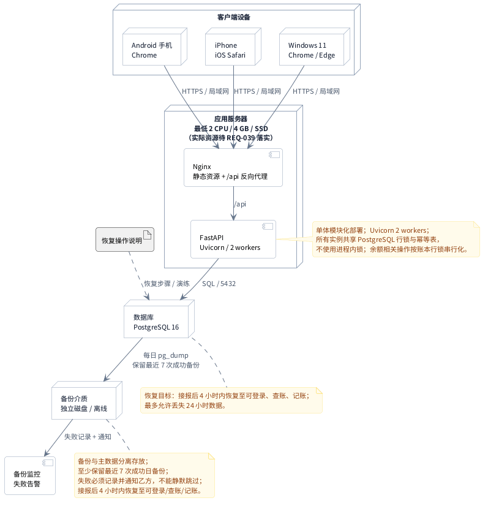

图4-3 区分移动/桌面浏览器、应用服务器、PostgreSQL 和独立备份介质。两个 Uvicorn worker 共享数据库锁和幂等表。HTTPS、数据库访问边界和备份介质分离用于降低凭据或账目暴露风险。

图中的最低2核CPU、4GB内存和SSD是需求基准，不是已落实的实际机器。每日备份需要监控成功间隔及失败补救，不能仅安排每日定时任务就声称满足“不超过24小时”。恢复介质、具体路径、设备版本和演练仍待落实。

### 4.5 UML用例图：角色与业务目标

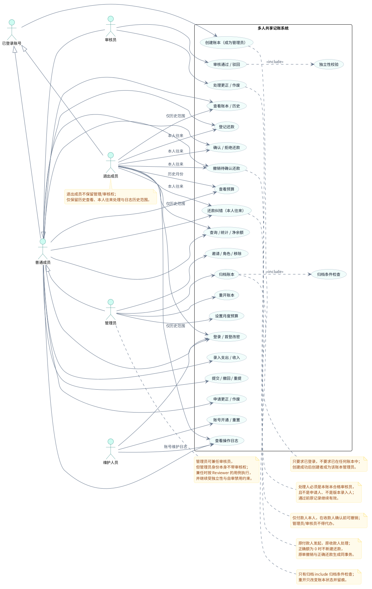

图4-4 单列已登录账号、普通成员、管理员、审核员、退出成员和维护人员。创建账本只要求登录，不要求事先是某个账本管理员；开通和重置账号归维护职责；查看、申请、审核和确认还款分别连接到适当参与者。

归档包含归档条件检查，重新开启不复用同一个检查目标。管理员兼任审核员时按审核员用例执行并继续受独立性约束。更正/作废处理排除申请人和版本录入人；还款纠错则由原收款人处理，不能用同一个“审核”用例掩盖差别。

### 4.6 UML状态图：收支版本生命周期

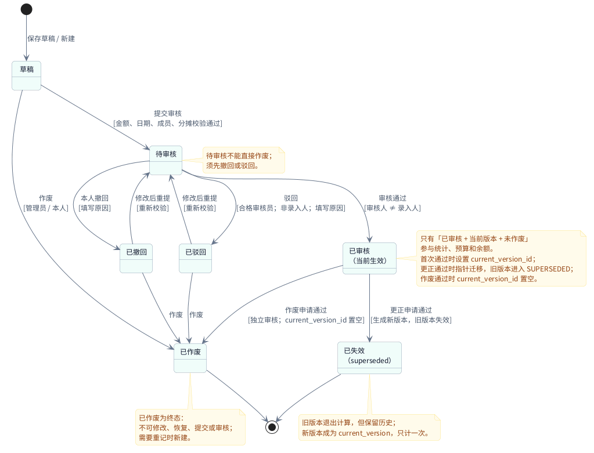

图4-5 包含草稿、待审核、已审核、已驳回、已撤回、已作废、已失效七个状态。草稿提交后进入待审；待审可以通过、驳回或由本人撤回；驳回和撤回后重新校验并提交。待审不得直接作废，须先撤回或驳回。

首次审核通过设置生效指针；更正通过产生新版本，旧版本进入 SUPERSEDED；作废通过使原版本进入 VOID 并清空生效指针。VOID 与 SUPERSEDED 保留历史但退出正式计算。已作废不可恢复或重新提交，需要重记时新建。

### 4.7 UML状态图：更正与作废申请

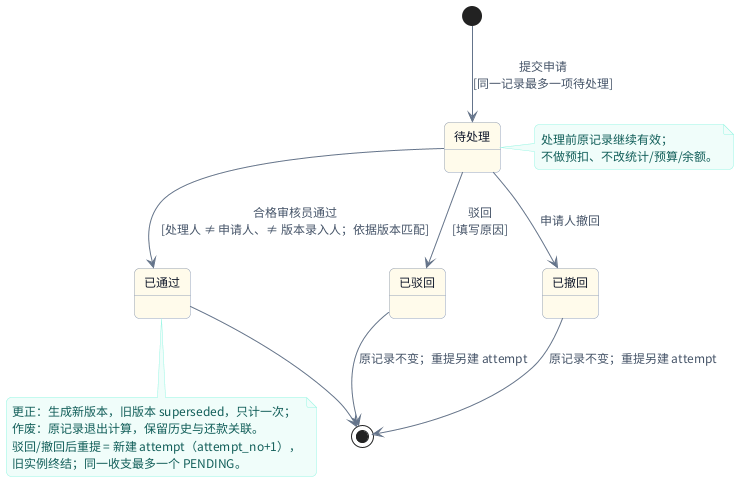

图4-6 将申请分为待处理、已通过、已驳回、已撤回。处理前原记录继续有效；通过时校验依据版本和处理人的独立资格。驳回或撤回使当前申请结束，重新申请建立 attemptNo 增加的新实例，不在同一图中同时声称“已终结”和“回到待处理”。

### 4.8 UML状态图：已确认还款纠错

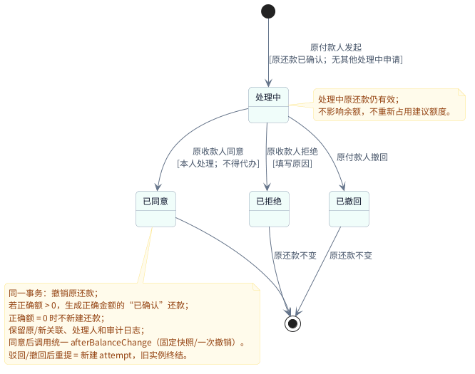

图4-7 明确原付款人申请、原收款人同意或拒绝，管理员和审核员不得代办。处理中原还款仍有效；同意时在同一事务内撤销原还款，正确金额大于零才生成正确的已确认还款，正确金额为零则不新建。原、新关联和处理日志均保留，并调用余额变更后的统一失效检查。

### 4.9 UML活动图：录入与审核流程


图4-8 用成员、前端、服务端、审核员泳道区分职责。前端负责输入反馈，服务端负责全量校验与最终授权；保存草稿和提交审核分支分开，避免误将保存等同于正式记账。审核通过统一更新版本、预算、余额和日志，驳回保留原因供修改重提。

图中的审核决定进入服务端处理前，必须接收当前审核员的明确操作；“锁后重查”包含账本角色、状态和独立性。图用于解释责任和分支，详细事务消息顺序由下一张时序图补充。

### 4.10 UML时序图：审核通过及幂等


图4-9 展开审核员、Web、Controller、ReviewService、BudgetService、SettlementService、AuditService 和 PostgreSQL 的消息顺序。同键请求先串行化，再区分原结果回放、请求内容冲突和首次执行；通过路径在锁后重新检查权限、版本与独立性。

支出更新发生月预算，收入不占预算；随后重算余额，在固定变更后快照上判定全部待确认还款的失效集合。审计及幂等结果与业务一同提交。任何一步失败都应回滚；状态或版本冲突返回明确错误而非伪装成功。

## 五、各功能模块的 UI 设计

### 5.1 设计工具、视觉与复用

本项目先有本地 HTML/CSS 参考稿，随后在 Figma 使用 SDS Assets 绘制五屏可编辑草图；2026年10月29日经本人选择，转为本地 React + shadcn/ui 继续设计。当前 shadcn 基础源码为组件套装，浏览器原型用于检查实际布局和交互，不能把它写成 Figma 导出文件。

视觉采用青绿主色 #0F766E、8px 圆角、1px 边框、无卡片阴影、16px 正文，辅助信息使用12/14px。错误同时有文字和图标，触控区域至少44px；360/390为手机检查宽度，768为中等宽度，1440为桌面参考宽度。

复用链路为“既有 SDS tokens → shadcn 语义变量 → components/ui → components/domain → pages/layouts”。基础组件不读取账本状态；MoneyText、StatusBadge、MemberAvatar、AllocationList、ReviewDetail 等业务组件统一表达金额、状态、成员和审核。两个审核页面复用同一详情组件，避免独立调整后产生规则或文案差异。

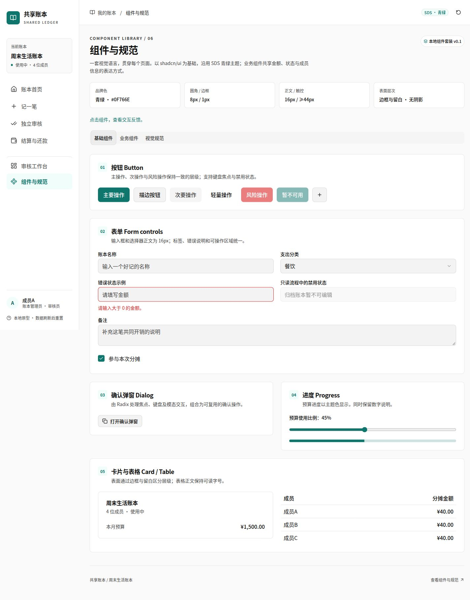

### 5.2 全部概念页面与当前材料覆盖

下表按方案中的概念编号核对。旧提交暂存目录的编号存在合并与偏移，正式导出前应统一，不能根据 PNG 数量直接认定17页全部完成。

| 编号 | 概念页面 | 当前设计材料与状态 |
| --- | --- | --- |
| 01 | 登录与首次改密 | 历史静态参考稿，待统一当前组件与完整改密流程 |
| 02 | 账本列表 | 历史静态参考稿，待接入当前组件 |
| 03 | 账本首页 | 当前本地交互原型；已有历史 Figma 草图 |
| 04 | 成员与邀请 | 历史管理端参考稿，邀请抽屉可见 |
| 05 | 邀请加入 | 目前合并在04的邀请展示，独立接收/确认页待补 |
| 06 | 支出录入 | 当前原型实现平均分摊；指定金额、草稿/撤回等待扩展 |
| 07 | 收入录入 | 历史参考稿，待当前组件化及交互 |
| 08 | 账目列表 | 历史参考稿；当前首页只有简化状态筛选 |
| 09 | 账目详情 | 审核详情提供代表信息，通用详情/历史版本入口待补 |
| 10 | 管理审核工作台 | 当前本地交互原型，队列/搜索/资格筛选/详情复用 |
| 11 | 移动审核详情 | 当前本地交互原型；有历史16px样张 |
| 12 | 更正/作废 | 历史管理端参考稿，完整申请与处理状态待补 |
| 13 | 预算与统计 | 历史参考稿；当前首页仅预算展示，不包含编辑与完整统计 |
| 14 | 结算/还款 | 当前原型与历史稿；登记、建议与历史纠错等待扩展 |
| 15 | 操作日志 | 历史参考稿，实际数据和权限过滤待实现 |
| 16 | 设置/归档 | 历史参考稿，归档/重开实际交互待补 |
| 17 | 账号维护 | 历史参考稿，真实核验与凭据流程待实现 |

### 5.3 M01账号与认证、M02账本管理

登录页集中呈现账号、密码、登录操作及统一错误信息；不存在账号与密码错误使用相同提示，连续第五次失败起暂停15分钟。首次登录/重置后必须改密，不能让用户绕过改密直接进入业务。账本列表显示使用中/归档状态、本人角色及进入入口，创建只要求已登录。

账号开通和重置在维护端进行，不提供自行注册或自助找回。空账本删除必须检查是否从未产生收支或还款记录；有历史数据只能按条件归档。以下为既有静态参考，不代表真实登录和新建功能已实现。

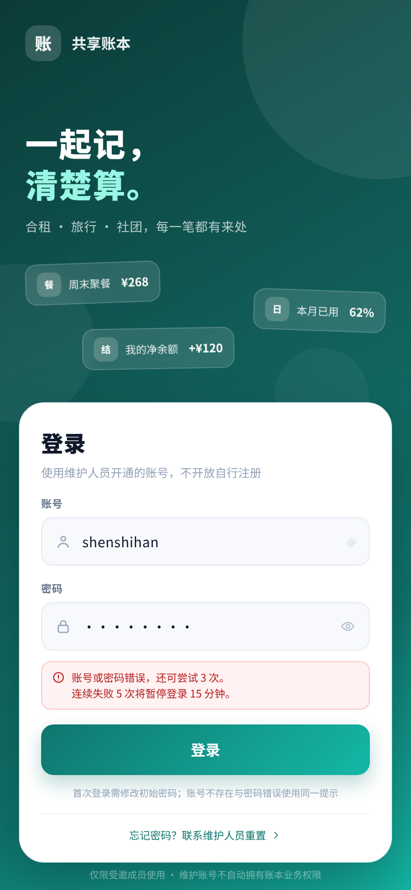

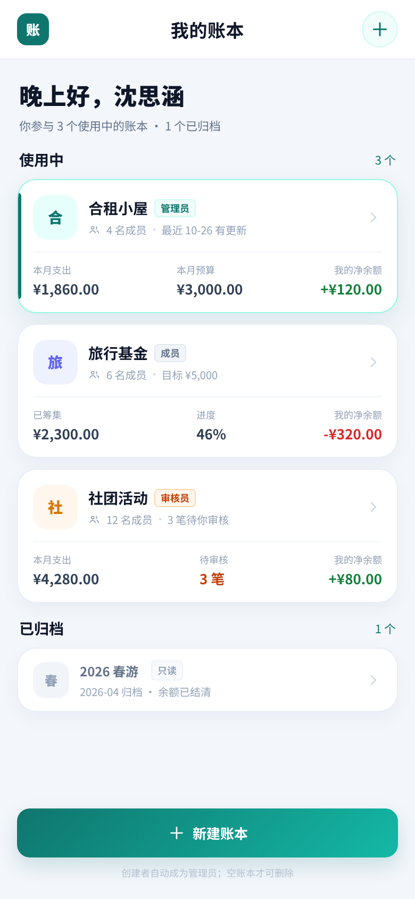

### 5.4 M03成员、邀请与权限

成员页显示成员身份、角色、加入顺序、状态和净余额；邀请抽屉展示链接与有效期，并提供撤销入口。角色调整需要区分管理员与审核员，不将单选角色控件作为唯一表达。退出或移除前显示未结清事项及最后管理员/审核员保护原因。

邀请接收页应在登录后显示目标账本及确认加入操作；邀请7天有效、成功使用一次即失效，在册成员重复打开不消耗名额。当前图只有管理端邀请抽屉，独立接收流程需补齐，尤其不能用“已展示链接”替代“已设计确认加入”。

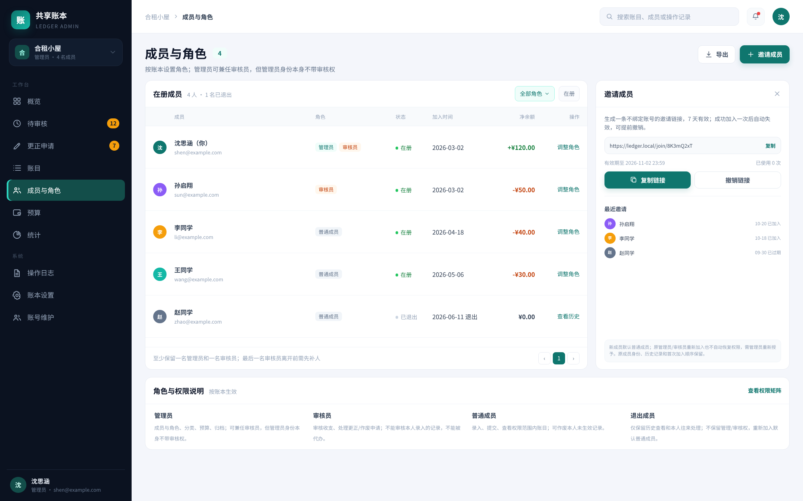

### 5.5 M04收支录入与账目查询

支出页优先呈现金额，再依次组织发生日期、分类、垫付人、说明、参与成员和分摊预览。当前原型支持三名成员平均分摊并展示尾差，例如100.01元分为33.34、33.34、33.33元。非法金额、空说明或无人参与时提供就近文字错误；提交后展示待审状态，不能立即增加正式预算和余额。

完整设计还应支持指定金额分摊、保存草稿、编辑本人允许状态及撤回。当前原型固定录入人为成员A且与垫付人一致，不能代替正式系统中录入人与付款人的独立字段和权限。

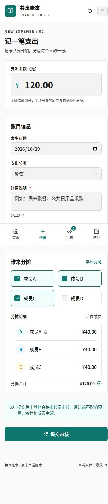

收入页应突出收款人和受益成员，支持平均或指定分配；收入审核通过影响余额和收入统计，但不占用支出预算。列表页提供类别、成员、时间、金额区间及状态筛选，筛选不改变用户可见范围。通用详情需显示版本、分配、审核原因和当前身份允许的操作。

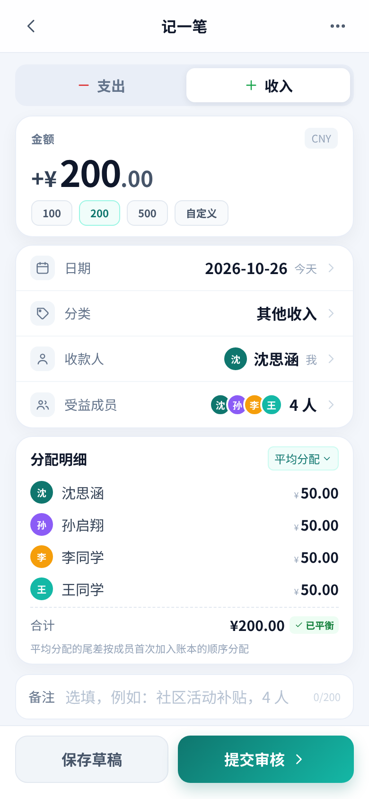

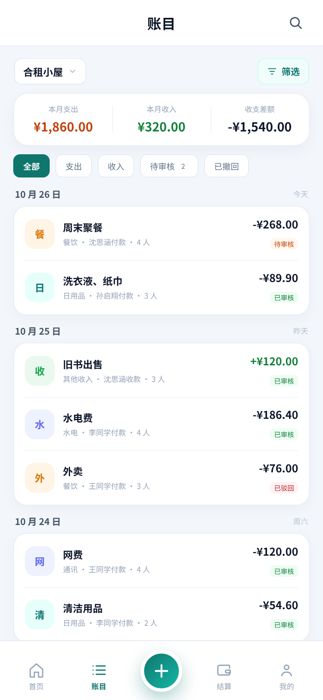

### 5.6 首页与M05独立审核

首页集中显示本人净余额、本月预算、待办、快捷操作及近期账目，帮助用户在较短路径内完成记账、审核或还款。预算区明确区分已审核支出与待审金额，不以“提交成功”误导为“已入账”。

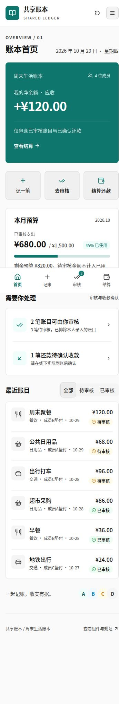

桌面审核工作台采用队列与详情并列，手机降级为卡片列表与单列详情。队列显示全部待审、当前可审数量和待审金额，支持关键词及审核资格筛选；详情包括金额、日期、分类、录入人、分摊、独立性说明和审核意见。通过前二次确认，驳回原因必填，本人录入禁用审核并说明原因。

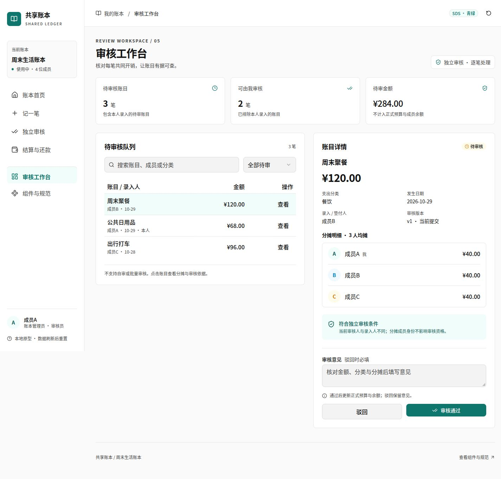

移动审核复用 ReviewDetail，避免桌面、手机对金额、分摊和独立性解释不一致。下图是先前的移动审核静态参考，当前原型已将相应信息转为可复用组件，示例中“可审核”只代表演示数据身份，不等于服务端鉴权。

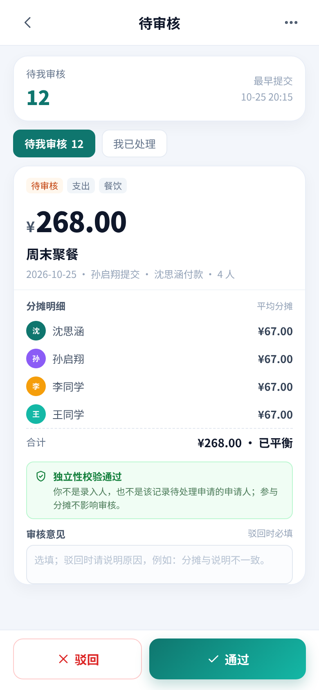

更正/作废页显示原值与拟修改值、依据版本、申请原因和对预算/余额的影响。处理前原记录继续有效；合格审核员处理时排除申请人和版本录入人，不能只用“管理员”身份放行。退款通过更正原支出处理，避免再记收入造成口径错误。

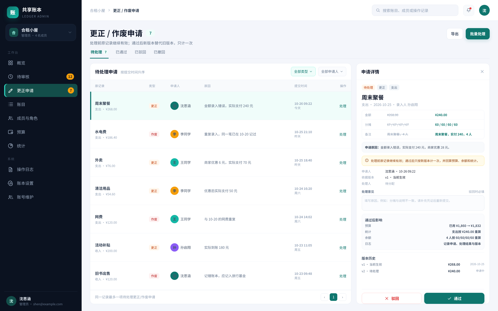

### 5.7 M06预算与M07统计

预算页按月展示额度、已审核支出、剩余和超支提示；预算编辑仅管理员可执行，在册普通成员仍可查看授权范围内预算。统计将收支分类、时间趋势、成员承担/享有与净余额分开显示，给出时间范围及有效版本口径。

超支只提示，不阻止保存、提交或审核。更正、作废需要回到业务发生月重算预算；收入、未审核和失效版本不得混入支出已用额。当前新原型只有首页预算展示，完整编辑和统计仍为历史参考设计。

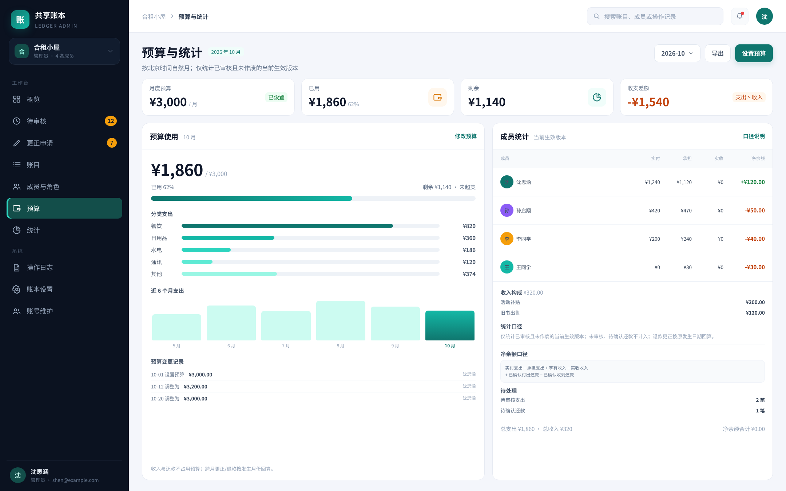

### 5.8 M08结算、还款与纠错

结算页分别显示成员净余额、待确认占用、当前可收/可付、建议和还款记录。登记普通还款只由实际付款人操作，金额不能超过双方当前可用额度；收款人实际到账后确认，其他成员不得代办。确认前不变余额，避免把“付款方登记”误当成资金已到账。

当前本地原型支持待确认与确认后的界面状态和余额变化，完整还款登记、拒绝、撤销、建议计算及历史纠错页面尚未补齐。历史稿用于展示这些区域的布局；最终 UI 必须区分“还款纠错申请”和“收支更正申请”。

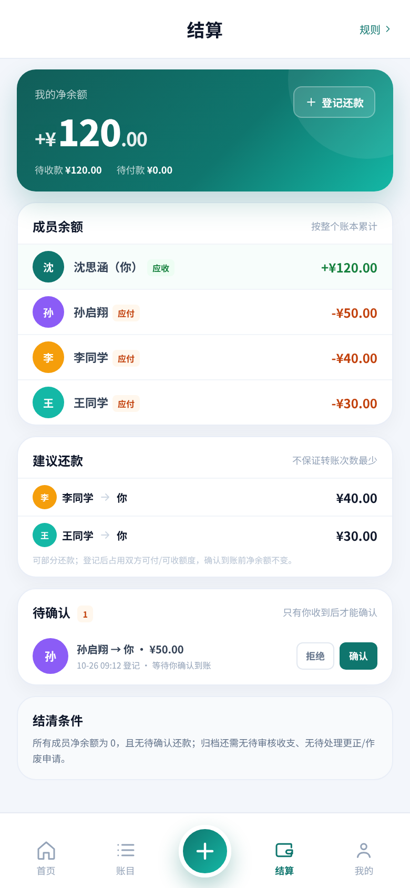

### 5.9 M09审计、设置与维护

日志页提供操作者、动作、时间、对象、变更前后、原因及关联标识筛选。日志查询沿用原业务可见范围，不能通过查看日志绕过账目权限；自动撤销要能定位触发操作和具体还款。设置页显示分类、归档检查项、冻结状态和重开操作，归档不删除历史。

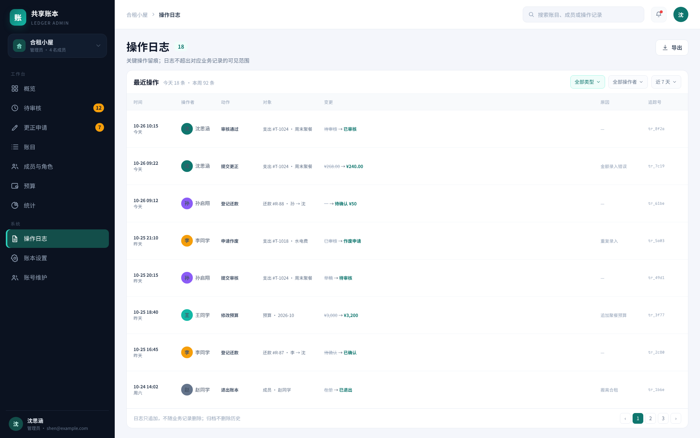

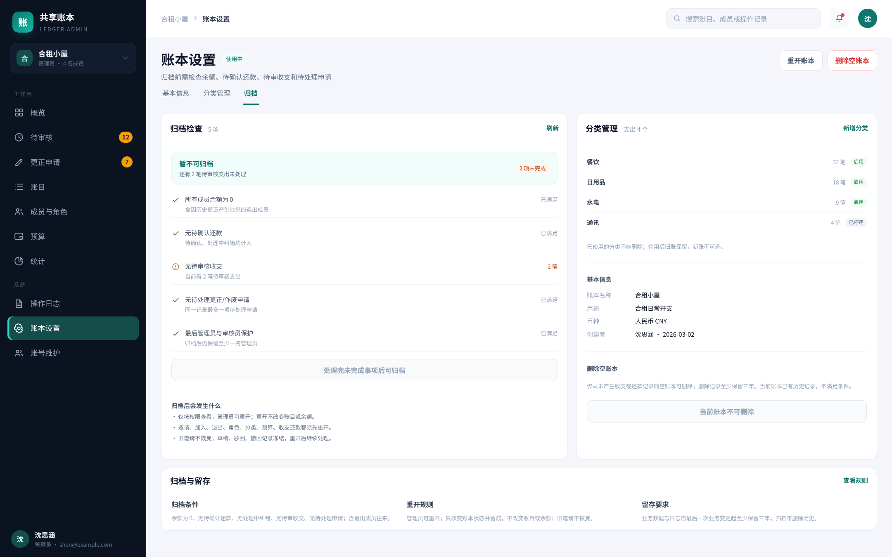

维护端将开通、重置、领用关系和交付渠道放在专门界面，不显示他人明文密码。重置需通过原登记渠道核验，无法核验转复核；不因维护身份自动看到业务账本。备份监控与恢复属于运维流程，当前不以一个装饰性按钮声称已有备份系统。

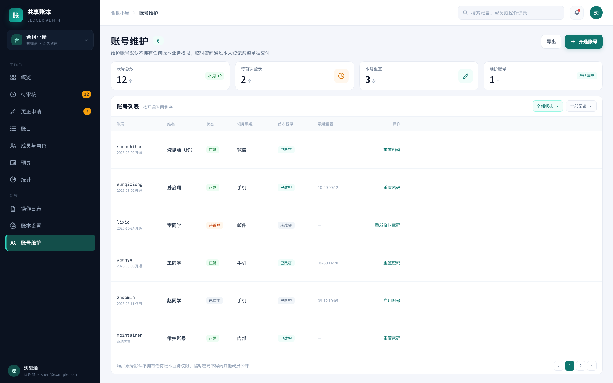

### 5.10 已有Figma设计证据与待补事项

既有 Figma 文件名为 SoftwareEngineeringUI，保存了移动端四屏与管理端一屏草图。下面是此前已保存的实际截图；本轮没有重新打开在线文件核验，不能据此宣称全17页都已在设计工具中绘制，也不能认为其后续组件化已经全部完成。

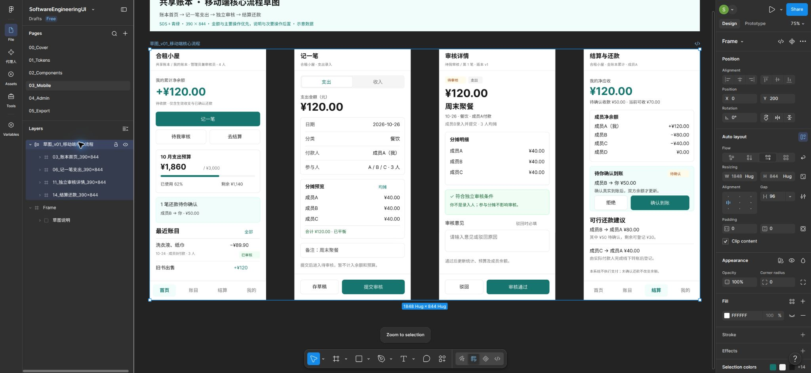

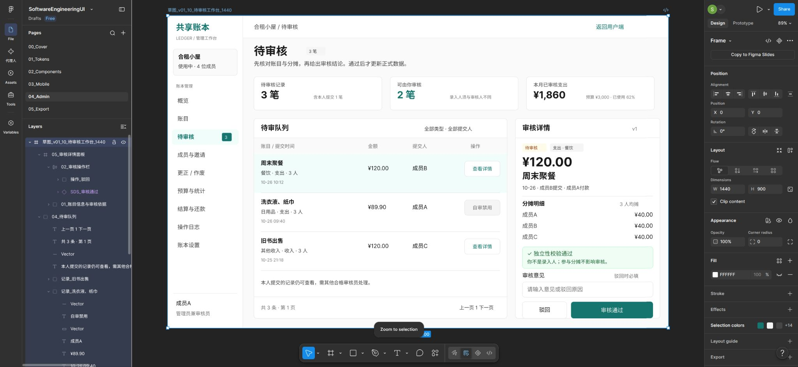

本地原型便于检查实际交互和组件复用，但课程明确要求使用 UI 设计工具。本稿保留工具使用证据，正式提交前仍需确认本地设计产出是否满足要求，并补足各模块最终界面。历史参考稿的字体、姓名示例和视觉细节尚未全部统一到新规范；最终导出应统一匿名成员、编号、状态和字号。

## 六、非功能设计与当前核验

### 6.1 设计如何支撑非功能需求

| 需求 | 既有指标 | 设计应对与当前状态 |
| --- | --- | --- |
| REQ-031 响应 | 约定规模与10会话并发下，九类操作各100次，至少95次2秒内完整成功 | 规划分页、索引、路由分包和事务；未做性能验收 |
| REQ-032 安全 | 账本隔离、角色/状态/历史权限一致 | 服务端统一授权，日志不扩大权限；仅有原型禁用和提示 |
| REQ-033 完整性 | 成功结果重登可查，同次重试只生效一次，冲突明确拒绝 | 规划数据库事务、版本号和幂等；当前内存示例不满足持久化验收 |
| REQ-034 恢复 | 成功备份间隔不超过24小时，最多丢24小时，接报4小时内恢复，至少7次成功备份 | 规划独立介质、失败通知和恢复说明；尚未配置或演练 |
| REQ-035 适配 | 中文、360/390/768/1440宽，正文16px，约定移动/桌面浏览器 | 已人工查看代表页面；未覆盖真实设备与软键盘 |
| REQ-036 易用性 | 5名合格新用户中至少4人一分钟内完成120元三人均摊提交和预览 | 首页快捷记账、表单顺序与分摊预览；尚未开展人员验收 |
| REQ-037 留存 | 从最后业务变更起至少3年，查看不重算，本期不清理 | 历史关系与时间戳设计；尚未实现存储与留存机制 |

### 6.2 已有核验事实

此前本地原型执行 `npm run build` 成功，其中包含 TypeScript 检查与 Vite 构建。浏览器人工操作查看了金额/必填错误、100.01元均摊尾差、本人不能自审、驳回需原因、通过确认、还款确认和队列搜索。代表页面在360、390、768、1440宽度未发现整页横向溢出，并读取到16px正文、8px圆角、1px边框和至少44px按钮。

初始示例中审核120元聚餐后，预算由680元变800元，A/B/C/D净余额为+80/0/-80/0，合计为零；失效的50元待确认还款自动撤销。另一轮初始数据确认收款50元后，A由+120变+70，B由-80变-30。详细记录见原型 `VALIDATION.md`。这些是本机原型的观察，不是正式系统的事务或并发证明。

本轮报告编制重新从 `.puml` 快照渲染9张图，检查正文引用及 PDF 版式；未编写测试，未执行哈希检查。真实后端、安全矩阵、系统性能、恢复演练、五人易用性、完整17屏和真实设备兼容均未验收。

## 七、AI辅助工具使用过程与本人思考

### 7.1 人与AI的职责

本人已确认的实际过程是：先思考并设计架构，与 AI 讨论技术栈和 UI 风格，再由 AI 将架构和规则转化为 UML 图，随后进行人工审核。2026年10月29日本人明确选择 shadcn/ui、本地设计、SDS青绿和组件复用。AI 提供的是候选方案、图源、组件实现和文字整理，本人保留范围选择、设计取舍和最终审核责任。

本章依据现有材料按可辨识的使用事件记录，不把多个模型互相审查等同于人工审核。部分历史交互只保留结果文档，尚不能证明每一次调用的完整提示词、原输出和人工处理；详见配套 `AI辅助记录.md`。模型版本以记录文件注明为准，未留存的内容不补造。

### 7.2 使用场景、结果、优缺点与修改结果

| 事件 | 场景与生成结果 | 优点与问题 | 修改/优化结果及人工边界 |
| --- | --- | --- | --- |
| AI-01 | 在本人架构思路基础上讨论 React单栈、双壳、SDS及后端方案 | 能快速比较与组织；易把计划写成已实现、把设计库当现成 npm 包 | 本人确认技术栈与风格；当前明确采用 shadcn 基础源码和共享tokens，原型/完整栈分开说明 |
| AI-02 | 依据需求和架构生成9张 PlantUML 及说明 | 图源可编辑、能快速补视角；初版出现单值角色、多重性及版本状态问题 | 本人确认做过人工审核；设计文件已修复角色关联、生效指针和历史区间，具体人工条目待补 |
| AI-03 | 2026-10-26 gpt-6.1-sol只读审查，形成D01～D10 | 发现模型/事务/权限不一致；审查结论本身也需对照原文件 | 依记录修订设计与图源，保留“设计修复不等于实现通过”；不把AI修订记为本人编辑 |
| AI-04 | gpt-6-astra继续复核，形成N01～N08和R01～R04 | 能追踪前次修复遗漏；多轮仍有索引唯一性残留，说明互审不保证完备 | 后续补部分唯一约束、版本录入人、申请attempt及统一锁序；最后残留修复后未再独立复审 |
| AI-05 | 生成本地HTML/CSS参考图并比较Material3与SDS青绿 | 能较快对比布局；旧稿存在紧凑字号和风格/实现栈残留 | 本人经讨论选择SDS青绿；旧图保留作参考，不伪装为最新定稿 |
| AI-06 | 在Figma使用SDS Assets构建五屏，整理按钮、分摊行和标签等 | 形成可编辑设计及实际截图；额度和原生操作使批量组件化受限 | 已有五屏和部分组件化，姓名匿名化；其余组件和12屏未完成，线上现状本轮未重核 |
| AI-07 | 本人指定本地shadcn路线后，AI实现组件套装和五屏原型 | 共享tokens和业务件可直接观察；开发中出现懒加载导入导致白屏，静态构建不能覆盖全部运行问题 | 经浏览器复查修正并重新构建；保留边界和操作记录，全部仍为AI辅助实现 |
| AI-08 | 本轮依据课程要求、需求、图源和UI材料生成报告草稿及PDF | 能整理覆盖关系与引用；容易夸大完成度、虚构个人体验或人工提交 | 本人补充实际参与方式；草稿区分当前/历史/待补，留出真实人工修订位置 |

### 7.3 代表性审查与设计改进

第一项是角色模型。单一 role 字段无法自然表达管理员兼任审核员；改为成员角色关联后，分别判断管理权与审核权，并保留撤权历史。这个修改不仅改变类图，也影响用例连接、界面角色标签和服务端检查。

第二项是收支版本。若更正直接覆盖已审核记录，旧金额和新金额可能重复累计，日志也难解释。将当前生效版本与历史版本分开，首次通过设置指针、更正迁移、作废清空，再让预算和余额只读取有效版本，形成一致计算口径。

第三项是幂等与事务。初稿文字和时序图的写入时点不一致，随后复核又发现同键并发和部分唯一索引问题。最终设计把同键串行化、锁后判定、业务/日志/幂等同事务写入一起说明。这表明“图能生成”和“多图规则一致”是两件事。

这些改进在本地审查文档和现有图源中可追溯。本人确已进行人工审核，但哪些具体条目由本人发现、哪些由AI发现、哪些由本人手工修改，仍应据实际补入人工修订记录，不能将上述三项一概写成本人独立发现。

### 7.4 个人思考草拟：待本人逐句核准

在本次设计中，我没有让工具直接决定全部方案，而是先形成架构思路，再讨论技术栈和UI风格，最后要求AI生成UML并进行人工审核。我选择本地shadcn/ui并保留SDS青绿，是希望设计能以可复用组件继续演进，而不是每个页面各自绘制按钮、状态和分摊行。

从现有材料可以看出，AI适合把已明确的规则快速转为图源、候选界面和说明，也能帮助暴露跨文件矛盾。但它可能把多重性画反、混淆录入人与付款人、遗漏状态守卫，或把尚未实现的设计写成已经完成。因此我需要根据需求检查角色、状态、金额和数据关联，并审阅最终报告，而不能只看生成物是否整齐。

上述段落是根据本人已确认经历拟写的反思，不额外声称本人已发现某个具体缺陷或亲手完成全部修改。提交前应由本人补充一个确实参与审核的具体例子，以及自己对工具操作、阅读成本和方案取舍的真实体验。

### 7.5 能否让人只负责检查校对

可以设计减少重复绘图和整理的工作流，但“校对”必须包含对需求、架构、权限、金额口径和异常策略的实质判断，而不只是检查错别字。若问题本身没有被明确提出，模型之间反复审查也可能共同沿用错误前提。

建议流程为：本人确定范围与关键不变量 → 将带编号需求和架构决策作为输入 → AI生成小批图源/组件 → 自动完成语法、构建或引用等机械检查 → AI对照需求寻找冲突 → 本人逐项判断、修改或保留 → 重渲染并核对图文UI → 分别保存AI稿与实际人工修订 → 本人审定后提交。每次使用至少记录场景、输入依据、生成结果、优缺点及优化后结果。

在这种流程中，AI可以承担重复表达和可机械检查的部分；本人仍需对架构取舍、业务规则及是否接受结果负责。没有实际完成的人为判断或修改，不应通过生成一段“个人总结”或创建一个名为“人工修改”的提交来替代。

## 八、Git过程记录、提交组织与后续工作

### 8.1 当前版本证据与不足

本轮开始前，仓库可见的两次提交均属于实验一，分别保存需求初稿和实验一最终需求/访谈；已有 `lab1-ai-draft` 与 `lab1-final` 标签。实验二材料此前保存在被忽略的 docs 目录，因此这些文件的存在不能证明实验二已经有完整Git过程记录。

本轮建立独立分支 `codex/lab2-report-draft`，将报告正文、AI记录、素材快照、PlantUML源与图、PDF和生成脚本作为一份AI辅助草稿保存。实验一master和标签不移动。此前人工审核以本人本轮说明为依据，具体意见和实际编辑记录待补，不倒填时间或伪造历史提交。

后续应由本人阅读报告和图源，选择真实修改点并填写“原内容—问题或保留理由—依据—实际修改—复核结果”，然后提交对应差异。配套 `人工修订记录模板.md` 用于记录，不能只改提交消息而没有实质修改，也不能把AI自动修改标成人工完成。

### 8.2 正式提交组织

```text
实验2_241220051_沈思涵/
├── 实验报告.pdf
├── UML/
│   ├── UML类图.png
│   ├── UML类图.puml
│   ├── UML组件图.png / UML组件图.puml
│   ├── UML部署图.png / UML部署图.puml
│   ├── UML用例图.png / UML用例图.puml
│   ├── UML状态图_收支版本.png / .puml
│   ├── UML状态图_更正申请.png / .puml
│   ├── UML状态图_还款纠错.png / .puml
│   ├── UML活动图_审核流程.png / .puml
│   └── UML时序图_审核通过.png / .puml
└── UI界面/
    └── 按最终统一编号保存各模块界面PNG
```

正式压缩包命名为 `实验2_241220051_沈思涵.zip`，顶层只保留上述一个目录。本轮只形成报告草稿和PDF预览，不修改既有提交暂存目录、不生成最终ZIP、不上传课程系统。

### 8.3 定稿前待办

- 本人核准项目描述、架构选择及第七章反思，补充实际人工审核条目和对应Git差异。
- 将当前原型与全17个概念页面对照，补齐邀请加入、通用详情、指定分配、完整还款纠错等缺口。
- 确认课程对UI设计工具的要求，补足设计工具操作证据和各模块最终图，统一字体、匿名示例、编号与状态文案。
- 复核类图多重性、当前生效指针、锁顺序、角色撤销和历史范围在所有图文中的一致性。
- 最终材料与实际成果一致后移除草稿标记，检查PDF、同名PlantUML图源和图像，再按期限提交。

## 参考资料与本地依据

1. 实验二任务要求：用户2026年10月29日提供的《实验二：软件设计与建模》。
2. 实验一需求基线：项目根目录 `requirements.md` V0.3，REQ-001～041；`chat.txt` 中任务范围及访谈/审查记录。
3. 本地设计资料：`docs/lab2/方案草稿.md`、`React_SDS_操作指南.md`、两份设计审查文档、`uml/`、`figma-draft/`、`refs/`、`ui-prototype/README.md` 和 `VALIDATION.md`。
4. OMG，Unified Modeling Language 2.5.1：[规范入口](https://www.omg.org/spec/UML/2.5.1)，[规范PDF](https://www.omg.org/spec/UML/2.5.1/PDF)。图种定义与交互图关系据此整理。
5. PlantUML：[类图](https://plantuml.com/class-diagram)、[组件图](https://plantuml.com/component-diagram)、[部署图](https://plantuml.com/deployment-diagram)、[用例图](https://plantuml.com/use-case-diagram)、[状态图](https://plantuml.com/state-diagram)、[活动图](https://plantuml.com/activity-diagram-beta)、[时序图](https://plantuml.com/sequence-diagram)。
6. shadcn/ui：[Vite安装](https://ui.shadcn.com/docs/installation/vite)、[主题](https://ui.shadcn.com/docs/theming)；Figma SDS：[官方源码](https://github.com/figma/sds)。组件源码许可和来源保存在本地原型目录。
